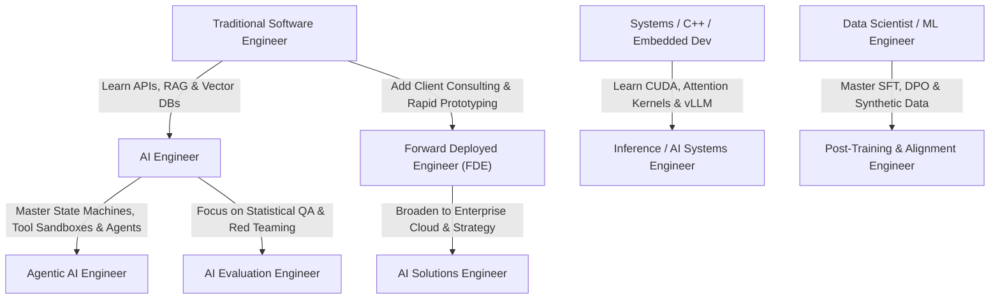

# The Modern AI Jobs Landscape & Career Guide

> A comprehensive reference guide to the latest, highest-demand roles in artificial intelligence—modeled after the **Forward Deployed Engineer (FDE)** archetype and detailing the specialized career paths across the foundation model lifecycle.

---

## Executive Summary & The AI Specialization Shift

Over the past few years, the artificial intelligence job market transitioned rapidly from generic titles ("Machine Learning Engineer", "Data Scientist") into highly specialized functional disciplines. As foundation models matured from exploratory research prototypes into production enterprise systems, companies discovered two critical realities:

1. **The Field Deployment Problem:** Standard SaaS engineering teams struggle to embed non-deterministic foundation models into messy legacy enterprise environments.
2. **The Specialization Bottleneck:** A single engineer cannot simultaneously optimize CUDA memory kernels (inference), design evaluation harnesses (evals), curate synthetic alignment datasets (post-training), and build autonomous multi-agent product workflows (agentic AI).

This guide analyzes the most prominent modern AI job profiles, beginning with the benchmark **Forward Deployed Engineer** and breaking down each role's day-to-day responsibilities, technology stack, hiring companies, and compensation.

---

## Quick Navigation

- [1. Forward Deployed Engineer (FDE / FDSE)](#1-forward-deployed-engineer-fde--fdse---the-benchmark)
- [2. AI Engineer (Product & Application)](#2-ai-engineer-product--application)
- [3. Agentic AI Engineer (Autonomous Systems)](#3-agentic-ai-engineer-autonomous-systems)
- [4. AI Evaluation (Evals) Engineer](#4-ai-evaluation-evals-engineer)
- [5. Inference & AI Systems Engineer](#5-inference--ai-systems-engineer)
- [6. Post-Training & Alignment Engineer](#6-post-training--alignment-engineer)
- [7. AI Solutions Engineer](#7-ai-solutions-engineer)
- [Master Comparison Matrix](#master-comparison-matrix)
- [Skill Progression & Transition Pathways](#skill-progression--transition-pathways)

---

## 1. Forward Deployed Engineer (FDE / FDSE) - *The Benchmark*

### The Core Question
> *"How do we embed directly with high-value enterprise customers to take cutting-edge AI capabilities and turn them into operational, mission-critical production systems?"*

### Role Overview
Originally pioneered by **Palantir** to integrate Gotham and Foundry into government, defense, and Fortune 500 infrastructure, the **Forward Deployed Engineer** has been enthusiastically adopted by frontier AI labs like **OpenAI**, **Anthropic**, and **Scale AI**. 

An FDE sits at the exact intersection of **Senior Software Engineer**, **Solutions Architect**, and **Strategic Product Consultant**. Rather than sitting in headquarters building theoretical features, FDEs are deployed directly alongside customer teams. They take frontier models (GPT-4o, Claude 3.7 Sonnet, Palantir AIP) and solve the real-world friction of enterprise data integration, latency, security, and workflow transformation.

### Core Responsibilities
- **On-the-Ground Integration:** Embed with client engineers to connect foundation models and AI platforms to proprietary databases, legacy ERPs, internal APIs, and secure clouds.
- **Custom Application Delivery:** Build bespoke, production-ready full-stack applications and automated pipelines tailored to specific operational pain points.
- **Productionization & Guardrails:** Design robust prompt architectures, context windows, function calling loops, and safety guardrails to withstand messy enterprise edge cases.
- **The Critical Feedback Loop:** Act as the intelligence bridge back to internal product and core research teams—translating field failures, latency blockers, and bespoke scripts into generalized platform features.
- **Technical Storytelling:** Present technical trade-offs, architecture decisions, and ROI metrics directly to client C-suites and engineering leads.

### Key Tech Stack & Skills
- **Core Languages:** Python, TypeScript/JavaScript, Go, SQL.
- **AI/LLM Platforms:** OpenAI / Anthropic APIs, Palantir Foundry/AIP, LangChain, LlamaIndex, Vector Databases (Pinecone, pgvector).
- **Enterprise Infrastructure:** AWS, Azure, GCP, Docker, Kubernetes, Terraform, OAuth/SSO, VPC peering, SOC2/HIPAA compliance patterns.
- **Soft Skills:** Extreme adaptability, high empathy, executive communication, ability to thrive in ambiguity and high-pressure client environments.

### Role Comparison
| Dimension | Traditional Software Engineer (SWE) | Solutions Architect (SA) | Forward Deployed Engineer (FDE) |
| :--- | :--- | :--- | :--- |
| **Primary Code Focus** | Internal core product features | High-level diagrams, minimal production code | Production-grade custom code embedded in customer stacks |
| **Location / Stakeholders** | HQ / Product Managers | Pre-sales / Enterprise Clients | On-site or deeply embedded with customer teams |
| **Success Metric** | Feature delivery, uptime | Deal closure, architectural sign-off | Customer workflow transformation & operational adoption |

### Who Hires FDEs
- **Frontier AI Labs:** OpenAI, Anthropic, Cohere.
- **Enterprise AI & Data Platforms:** Palantir, Scale AI, Databricks, Snorkel AI.
- **Vertical AI Unicorns:** Harvey (Legal AI), Abridge (Medical AI), Ramp.
- **Compensation Range (US):** \$180,000 – \$320,000 base + equity ($250,000 – $600,000+ total compensation).

---

## 2. AI Engineer (Product & Application)

### The Core Question
> *"How do we reliably build software products around foundation models that someone else pre-trained?"*

### Role Overview
Popularized by the Latent Space community and Swyx, the **AI Engineer** has become the standard software engineering role of the generative AI era. Unlike traditional ML engineers who train models from scratch with PyTorch and massive compute clusters, the AI Engineer treats foundation models as programmable cognitive primitives via APIs or open-weight weights.

### Core Responsibilities
- **RAG Architecture Design:** Build end-to-end Retrieval-Augmented Generation systems—chunking strategies, hybrid search (keyword + dense semantic), rerankers, and contextual retrieval.
- **Prompt Engineering & Structured Outputs:** Enforce deterministic JSON outputs, Pydantic schemas, and structured response contracts from probabilistic models.
- **Vector & Data Pipeline Management:** Ingest, embed, and index large document corpora into vector databases with fast semantic indexing.
- **Cost & Latency Optimization:** Implement model routing (sending simple queries to lightweight models like GPT-4o-mini or Claude 3.5 Haiku, complex reasoning to flagship models), prompt caching, and response streaming.

### Key Tech Stack & Skills
- **Languages:** Python, TypeScript (Next.js, Node.js).
- **Frameworks:** LangChain, LlamaIndex, Instructor, LiteLLM, FastAPI.
- **Databases:** PostgreSQL (pgvector), Pinecone, Qdrant, Weaviate, Redis (for semantic caching).
- **Observability:** LangSmith, Arize Phoenix, Helicone, Langfuse.

### Who Hires AI Engineers
- Startups across all verticals (Y Combinator batches are now ~70%+ AI engineering focused).
- Big Tech (Google, Meta, Microsoft, Amazon).
- B2B SaaS companies adding AI copilots to existing software suites.
- **Compensation Range (US):** \$150,000 – \$250,000 base + equity ($200,000 – $450,000 total compensation).

---

## 3. Agentic AI Engineer (Autonomous Systems)

### The Core Question
> *"How do we design autonomous, multi-step systems capable of planning, tool execution, self-correction, and long-horizon tasks without derailing?"*

### Role Overview
While an AI Engineer builds single-turn or simple retrieval pipelines, the **Agentic AI Engineer** builds autonomous, non-deterministic agent workflows. These agents possess short- and long-term memory, reason across multiple iterations, call arbitrary external tools (browsers, shell terminals, APIs), evaluate their own outputs, and adapt when encountering unexpected errors.

### Core Responsibilities
- **Agent Topology Design:** Architect state graphs, supervisory hierarchies, and multi-agent coordination loops (e.g., Planner $\rightarrow$ Executor $\rightarrow$ Critic $\rightarrow$ Verifier).
- **Context & State Management:** Maintain state across long conversational or execution trajectories; implement intelligent context window pruning to avoid context pollution.
- **Tool Integration & Sandboxing:** Provide agents with deterministic, least-privilege tool execution environments (sandboxed code execution, browser automation, REST APIs).
- **Self-Healing & Error Recovery:** Build validation retry loops where the agent inspects stack traces or lint errors and autonomously adjusts its next tool call.

### Key Tech Stack & Skills
- **Orchestration Frameworks:** LangGraph, CrewAI, AutoGen, Semantic Kernel, Temporal (for resilient long-running workflows).
- **Execution Environments:** Docker containers, WebAssembly sandboxes, headless Playwright/Puppeteer.
- **Core Concepts:** ReAct prompting, Reflection/Self-Critique patterns, Plan-and-Solve, Human-in-the-Loop (HITL) checkpoints.

### Who Hires Agentic AI Engineers
- AI coding assistant companies (Cursor, Cognition / Devin, GitHub, Replit).
- Autonomous workflow automation platforms (Airtable, Zapier, Adept, Lindy).
- Enterprise robotic process automation & back-office automation companies.
- **Compensation Range (US):** \$175,000 – \$280,000 base + equity ($250,000 – $550,000 total compensation).

---

## 4. AI Evaluation (Evals) Engineer

### The Core Question
> *"How do we scientifically prove that a model upgrade, prompt tweak, or pipeline change actually improved our system instead of quietly breaking critical behaviors?"*

### Role Overview
Traditional unit tests (e.g., `assert output == expected`) fail when testing probabilistic, natural-language systems. The **Evaluation Engineer** is the modern quality assurance and reliability engineer for generative AI. They build the measurement, benchmarking, and automated regression-testing harnesses that allow engineering teams to ship model updates with statistical confidence.

### Core Responsibilities
- **Golden Dataset Curation:** Build representative test suites composed of synthetic edge cases, historical failure points, and real anonymized user traffic.
- **Grading Pipeline Implementation:** Design deterministic rule-based validators (regex, schema checking, code execution) and calibrated "LLM-as-a-judge" grading rubrics.
- **Red Teaming & Safety Testing:** Conduct systematic adversarial testing to identify prompt injection vulnerabilities, jailbreaks, data leakage, and harmful outputs.
- **CI/CD Regression Harnesses:** Integrate evaluations into automated pull request workflows (preventing merges if factual accuracy or tone metrics drop).

### Key Tech Stack & Skills
- **Tools:** Promptfoo, Braintrust, DeepEval, Ragas, Cleanlab.
- **Techniques:** G-Eval, Bradley-Terry rating models, semantic similarity metrics, statistical hypothesis testing.
- **Languages:** Python, SQL, statistical modeling packages (scipy, pandas).

### Who Hires Evals Engineers
- Frontier AI research labs (OpenAI, Anthropic, Mistral).
- Highly regulated enterprise AI (Healthcare, FinTech, Legal Tech, Defense).
- Large-scale consumer AI products (character AI, personal assistants).
- **Compensation Range (US):** \$160,000 – \$260,000 base + equity ($220,000 – $480,000 total compensation).

---

## 5. Inference & AI Systems Engineer

### The Core Question
> *"How do we make model serving 10x faster, cut GPU memory footprints in half, and maximize tokens-per-second per dollar?"*

### Role Overview
Inference is where 80%+ of lifetime model compute expenditure occurs. **Inference Engineers** (and AI Systems Engineers) are performance obsessives who specialize in the lowest levels of the AI infrastructure stack. They optimize model execution on specialized hardware (NVIDIA H100s/B200s, AMD MI300, Apple Silicon, Groq LPUs, Google TPUs).

### Core Responsibilities
- **Serving Engine Optimization:** Deploy and tune state-of-the-art inference engines, optimizing continuous batching, chunked prefill, and PagedAttention.
- **Model Compression & Quantization:** Apply post-training quantization schemes (FP8, AWQ, GPTQ, GGUF) without degrading benchmark accuracy.
- **Kernel Engineering:** Write custom CUDA or Triton kernels to eliminate memory bandwidth bottlenecks in non-standard attention or activation layers.
- **Cache & Memory Management:** Implement KV-cache offloading, prefix caching, speculative decoding, and speculative sampling pipelines.

### Key Tech Stack & Skills
- **Engines:** vLLM, TensorRT-LLM, SGLang, TGI (Text Generation Inference), Triton Inference Server.
- **Languages & Frameworks:** C++, CUDA, Triton, Python, PyTorch internals.
- **Hardware Architecture:** GPU memory hierarchies (HBM3 vs. SRAM), NVLink topologies, distributed inference (Tensor Parallelism, Pipeline Parallelism).

### Who Hires Inference Engineers
- Cloud Hyperscalers & AI Infrastructure Providers (CoreWeave, Lambda Labs, Together AI, Fireworks AI, AWS, GCP, Azure).
- Chipmakers (NVIDIA, AMD, Groq, Cerebras).
- High-traffic consumer AI platforms serving billions of daily tokens.
- **Compensation Range (US):** \$200,000 – \$350,000 base + equity ($300,000 – $750,000+ total compensation).

---

## 6. Post-Training & Alignment Engineer

### The Core Question
> *"How do we take raw pre-trained model weights and teach them to follow instructions, reason carefully, adhere to safety guardrails, and master specialized domains?"*

### Role Overview
While pre-training creates the foundational knowledge base of a model, **Post-Training** transforms raw next-token prediction into a helpful, steerable assistant or reasoning engine. Post-Training Engineers specialize in the art and science of Supervised Fine-Tuning (SFT), preference alignment (DPO, KTO, RLHF), and test-time reasoning verifiers (process reward models).

### Core Responsibilities
- **Synthetic Data Generation Pipelines:** Design LLM-driven data generation, filtering, and deduplication workflows to create millions of high-quality training pairs.
- **Alignment & Preference Tuning:** Train models using Direct Preference Optimization (DPO), Reinforcement Learning from Human Feedback (RLHF), or Reinforcement Learning from AI Feedback (RLAIF).
- **Reasoning & Verifier Engineering:** Train outcome and process-based reward models (PRMs) to guide reasoning models (e.g., chain-of-thought verification, math/coding problem step verification).
- **Domain Adaptation:** Fine-tune open-weights models (Llama 3, Mistral, Qwen) on proprietary domain knowledge using LoRA / QLoRA or full parameter updates.

### Key Tech Stack & Skills
- **Frameworks:** Hugging Face TRL / PEFT, DeepSpeed, Megatron-LM, Axolotl, vLLM (for rollout generation during RL).
- **Mathematics & Algorithms:** Reinforcement learning, PPO, DPO loss formulations, cross-entropy calibration.
- **Data Engineering:** Ray, Apache Spark, tokenization algorithms, data cleaning at petabyte scale.

### Who Hires Post-Training Engineers
- Frontier AI research organizations (Anthropic, OpenAI, DeepMind, Meta FAIR).
- Open-weights model builders (Mistral, Cohere, Technology Innovation Institute).
- Vertical foundation model companies (e.g., specialized medical, coding, or legal model labs).
- **Compensation Range (US):** \$220,000 – \$380,000 base + equity ($350,000 – $800,000+ total compensation).

---

## 7. AI Solutions Engineer / AI Solutions Architect

### The Core Question
> *"How do we translate a company's high-level business problem into an architecturally sound, secure, and compliant AI solution blueprint?"*

### Role Overview
The **AI Solutions Engineer** acts as the high-level bridge between commercial stakeholders, client executive leadership, and deep technical execution teams. While an FDE spends 80% of their time writing custom production code on-site, the Solutions Engineer focuses on architectural blueprints, technical pre-sales, rapid proof-of-concept (PoC) validation, and ensuring security/compliance readiness.

### Core Responsibilities
- **Technical Discovery & Feasibility Scoping:** Unpack customer requirements and assess whether a problem is best solved by standard heuristics, RAG, fine-tuning, or multi-agent workflows.
- **Rapid PoC Development:** Build functional lightweight demonstrators within days to validate ROI and technical feasibility.
- **Security & Compliance Architecture:** Architect zero-retention data pipelines, private VPC endpoints, PII masking layers, and SOC2/HIPAA compliance architectures.
- **Enterprise Enablement:** Conduct architecture reviews, author best-practice whitepapers, and train enterprise client teams.

### Key Tech Stack & Skills
- **Cloud Ecosystems:** AWS Bedrock, Google Cloud Vertex AI, Azure OpenAI Service.
- **Enterprise Integrations:** Snowflake, Databricks, Salesforce, SAP, Active Directory.
- **Skills:** Enterprise systems architecture, high-level Python prototyping, executive communication, RFP response orchestration.

### Who Hires AI Solutions Engineers
- Cloud Giants (Google Cloud, Microsoft Azure, AWS).
- Enterprise AI Vendors (Dataiku, C3.ai, DataRobot, Snowflake).
- Top Tier Tech Consultancies (Accenture, McKinsey QuantumBlack, BCG X).
- **Compensation Range (US):** \$150,000 – \$240,000 base + bonus + equity ($200,000 – $380,000 total compensation).

---

## Master Comparison Matrix

| Role | Primary Orientation | Primary Focus | Code Depth | Key Technology / Framework | Typical Background |
| :--- | :--- | :--- | :--- | :--- | :--- |
| **Forward Deployed Engineer (FDE)** | Customer & Product | Embedded client production deployments | High | Python, Enterprise Cloud, Full-stack, AIP/APIs | Full-Stack SWE, Solutions Architect, Ex-Consultant |
| **AI Engineer** | Product & Features | RAG, prompt chains, LLM app features | High | TypeScript, Python, LangChain, Vector DBs | Frontend / Full-Stack SWE |
| **Agentic AI Engineer** | Autonomous Workflows | Multi-agent state loops, tool execution | Very High | Python, LangGraph, AutoGen, Sandboxed Runtimes | Backend SWE, Distributed Systems |
| **AI Evaluation Engineer** | Quality & Reliability | Automated grading, benchmarking, red teaming | Medium-High | Promptfoo, Braintrust, Python, Statistics | QA Automation, Data Science, ML Testing |
| **Inference Engineer** | Systems & Hardware | Throughput, latency, GPU memory optimization | Extreme (Low-level) | C++, CUDA, Triton, vLLM, TensorRT-LLM | Systems Programmer, HPC, Game Engine Dev |
| **Post-Training Engineer** | Models & Weights | SFT, DPO, RLHF, synthetic datasets | Extreme (Math/ML) | PyTorch, DeepSpeed, Hugging Face TRL, Ray | ML Researcher, PhD in NLP/ML |
| **AI Solutions Engineer** | Pre-Sales & Strategy | PoCs, architecture blueprints, governance | Medium | Cloud AI Platforms (Vertex, Bedrock), Python | Solutions Architect, Sales Engineer |

---

## Skill Progression & Transition Pathways

### How to Prepare for Forward Deployed & AI Roles
1. **Ship Real End-to-End Apps:** Avoid toy Jupyter notebooks. Build full-stack applications with user authentication, database persistence, streaming LLM completions, and automated evaluations.
2. **Master Context Engineering & Tool Use:** Understand token budgets, context caching, structured tool outputs (JSON schemas), and error-recovery retry loops.
3. **Practice in Ambiguity:** The hallmark of a Forward Deployed Engineer is taking a vague, high-level business requirement ("Make our claims processing 5x faster") and self-directing the architecture, deployment, and customer buy-in.
